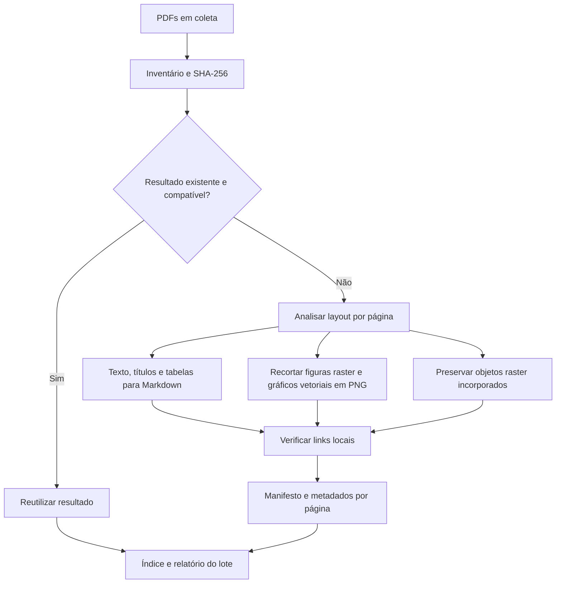

# Conversão dos PDFs para Markdown

Execute na raiz do projeto (Python 3.10 ou superior):

```powershell
./scripts/convert_pdfs.ps1
```

O comando cria `.venv-pdf`, instala as versões fixadas em `requirements-pdf.txt` e processa recursivamente os PDFs de `coleta`. A primeira instalação exige internet; a conversão é local e não envia documentos a serviços externos.



## Saída

`output/pdf/README.md` é o índice navegável. Cada PDF tem uma pasta com o mesmo nome, preservando subpastas de origem:

- `document.md`: conteúdo por página, figuras com links relativos e lista dos objetos raster.
- `text.md`: extração direta de todo o texto disponível, por página, como salvaguarda contra omissões do detector de layout. Páginas cujo Markdown contém menos da metade dos caracteres extraíveis também recebem um complemento textual em `document.md`, claramente identificado; pode haver repetição de texto e de camadas existentes no próprio PDF.
- `images/`: recortes renderizados a 180 DPI; incluem diagramas vetoriais detectados. A numeração nos nomes gerados pela biblioteca começa em zero.
- `raster/`: imagens incorporadas preservadas no formato original, deduplicadas por objeto dentro do PDF. Podem ser apenas componentes de figuras; transparência e máscaras separadas podem afetar sua aparência. Use os recortes para a aparência composta.
- `pages.json`: metadados de layout e contagem de caracteres por página.
- `rasters.json`: dimensões, objeto PDF e primeira página de ocorrência de cada raster.
- `manifest.json`: hash do original, parâmetros, arquivos gerados e avisos.

`output/pdf/report.json` consolida o lote e registra falhas. Uma falha de layout em uma página usa texto simples e uma imagem da página inteira, com aviso explícito. Uma falha de documento não interrompe os demais, mas resulta em código de saída 1.

## Opções

```powershell
./scripts/convert_pdfs.ps1 -Workers 3 -Dpi 200
./scripts/convert_pdfs.ps1 -Force
./.venv-pdf/Scripts/python.exe scripts/pdf_to_markdown.py --input coleta --output output/pdf --workers 3
./.venv-pdf/Scripts/python.exe scripts/validate_pdf_markdown.py
```

Hashes, versão da pipeline, versões das bibliotecas e DPI determinam a reutilização. Arquivos de saída ausentes também provocam reconversão. `--force` refaz os documentos; não elimina arquivos antigos não referenciados. Para uma saída completamente limpa, use um novo diretório `--output`. Não edite manualmente os resultados que pretende regenerar. `--limit N` processa apenas uma amostra e gera um índice/relatório dessa amostra; use uma pasta de saída separada para testes.

## Limites da conversão

PDF descreve posições gráficas, não a estrutura lógica do artigo. A ordem de leitura em múltiplas colunas, equações, tabelas complexas, cabeçalhos e agrupamento de painéis são inferidos e podem exigir revisão. Fórmulas não são transcritas semanticamente para LaTeX. A biblioteca pode recortar componentes e elementos decorativos separadamente. A preservação adicional dos objetos raster evita depender apenas da detecção de figuras.

Páginas com menos de 40 caracteres extraídos são sinalizadas para revisão/OCR; a pipeline não executa OCR automaticamente. No inventário inicial deste lote, todas as 1.639 páginas dos 97 PDFs tinham texto extraível. Isso não garante que todo texto dentro de imagens esteja disponível como texto.

Os PDFs originais são preservados. A validação automatizada confere integridade, cobertura das páginas e arquivos referenciados; não comprova equivalência semântica integral com os PDFs.

`validation.json` registra o resultado da verificação de integridade e notas de qualidade: caracteres de substituição (`�`) e páginas cujo Markdown ficou significativamente menor que o texto extraível. Essas notas são sinais para revisão, não correções automáticas nem prova de perda de conteúdo.
