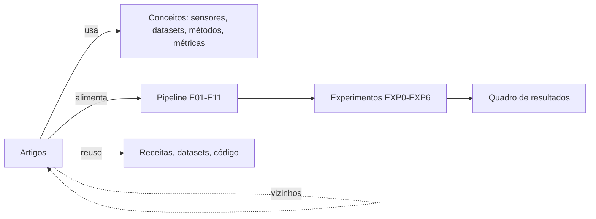

# Mapa do grafo

## Tipos de aresta
- **artigo → conceito** (propriedades `sensores`, `tarefas`, `metodos`, `datasets`, `metricas`, `ferramentas`): conecta artigos que usam o mesmo dado ou método.
- **artigo → etapa** (`etapas_pipeline`): diz em que ponto do fluxo cada artigo ajuda.
- **artigo ↔ artigo**: relação explícita do documento original (6 pares) e vizinhos por entidades em comum.
- **experimento → artigos/etapas**: hipótese, base bibliográfica e protocolo.

## Como ler
- Selecione um dataset (ex.: [[SpaceNet 7 (MUDS)]]) e veja os artigos ao redor: são os que podem compartilhar rótulos ou protocolo.
- Selecione uma etapa e veja os conceitos e artigos que a sustentam.
- Etapas contíguas formam a espinha dorsal: E01 → E11. Abra [[Pipeline.canvas]].
